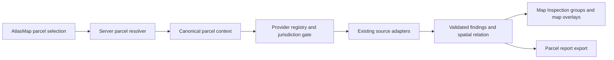

# Proposed unified parcel intelligence engine

This extends the existing `/parcel-inspection` flow and `MapInspection`; it does not create another map or replace the drawing report. See [audit](MASTER_AUDIT.md) and [risks](RISK_AND_VALIDATION.md).

## Minimal architecture



1. **Resolve before query.** The browser sends `parcelKey`; the server retrieves the selected source's exact OBJECTID and full geometry. Treat browser geometry as a view hint only. Return a stable parcel identity composed of source ID, source record ID, jurisdiction (state/county/place where verified), source update date and geometry fingerprint. Reject missing/invalid geometry; never join by address alone. Preserve the current click and selection UI.
2. **Small provider registry.** Extend the `LAND_OVERLAYS`/`PARCEL_INSPECTION_GROUPS` metadata, or add one server-only registry referenced by those definitions, with provider ID, endpoint, discipline tags (many-to-many), supported geometry/query mode, actual coverage rule, field map, refresh policy, license state, timeout and result cap. Keep current specialized adapters (`phase2.ts`, `phase3.ts`, `arcgis-query.ts`) and gradually move duplicated query policy from `/report` only when a shared contract is proven. No database, queue, or generic workflow framework is needed initially.
3. **Jurisdiction-aware routing.** Use authoritative parcel source jurisdiction first, then Census/state/city boundaries if needed. A state bounding box is a cheap prefilter, not coverage proof. For city utilities and zoning, require a verified service footprint or jurisdiction membership, plus source-specific record evidence. If coverage is unknown, return `not_checked` or `unavailable`; do not turn an empty ArcGIS response into a clean bill of health.
4. **Bounded queries.** Fetch essential assessor/land facts first; query high-value parcel screening groups in bounded concurrency with per-source timeout and cancellation. Show source groups progressively in `ParcelFindings`; later source failures cannot erase earlier results. Use ArcGIS polygon intersections and point distance only for supported source geometries. Page up to a strict budget, preserve `partial` when capped, and never silently discard records.
5. **Spatial verification.** Normalize CRS to GeoJSON WGS84/longitude-latitude at the adapter boundary, retain original WKID and geometry precision. Validate rings, holes, self-intersections, coordinate bounds and shape size. For returned polygons/lines, locally recheck intersection against authoritative parcel geometry; for points compute boundary distance, with the provider's position accuracy as uncertainty. Never assign a building or utility to a parcel from proximity alone. Record relation method, distance, source accuracy and a reason. Use a proven geometry library if fixture tests expose limitations in `parcel-inspection.ts`/`parcel-analysis.ts`; avoid a custom topology engine.
6. **Normalize and preserve provenance.** Adapter maps raw fields into a shared finding, stores original record ID/URL, provider, query time, source update/record dates, source geometry, attribute subset, coverage and rights. Deduplicate only on `(provider, original ID, record type)` or a verified crosswalk; show multiple records where they describe different things. One finding can appear under multiple of the 12 discipline headings but has one identity and one map feature.
7. **Cache by evidence version.** Cache key = canonical parcel identity + geometry fingerprint + provider ID/schema version. Retain source-specific TTL and `checkedAt`; do not cache outages as negatives. Existing 3-minute process Map may remain as a first short-term layer, but serverless instances will not share it. Add shared storage only if measured latency/cost requires it. Prevent same-instance duplicate queries with an in-flight map; cap size and do not cache personal data without retention review.

## Result contract

The API can evolve `ParcelInspectionReport` additively so current `MapInspection` and export keep working:

```ts
type State = "found" | "nearby" | "estimated" | "unavailable" |
  "not_checked" | "source_error" | "no_features" | "partial";
type Finding = {
  id: string; disciplineIds: string[]; providerId: string; originalId: string;
  sourceUrl: string; recordUrl?: string; recordDate?: string; sourceUpdatedAt?: string;
  checkedAt: string; state: State;
  relation: "inside" | "intersects" | "nearby" | "unknown";
  relationMethod: string; distanceMeters?: number; positionalAccuracyMeters?: number;
  geometry?: GeoJSON.Geometry; originalCrs?: string;
  attributes: Record<string, string | number | boolean | null>;
  coverage: "confirmed" | "unknown" | "outside";
  verification: "official_record" | "derived" | "unverified";
  licenseId?: string; confidence?: "high" | "medium" | "low" | "unknown";
};
```

`no_features` is allowed only when a provider query completed within known coverage and result limits; it describes the **dataset**, not real-world absence. `source_error` captures request/schema failures; `unavailable` means source inaccessible or unsupported; `not_checked` means no eligible or authorized query; `estimated` is derived from geometry/model and must state method. `nearby` is a relation, not an automatic hazard finding. Keep current statuses during migration via an explicit compatibility mapper; do not change existing API consumers in one deployment.

## Map and product behavior

- Preserve `AtlasMap`, basemaps, selection, active overlays, `MapInspection` mobile sheet, `ParcelFindings` group visibility and selected-feature highlight. Map features are returned only where geometry is available and a source allows display. A finding without geometry still belongs in the panel.
- The 12 disciplines are headings/facets over shared findings: buildings, cadastral, utilities, survey/topography, legal, permits/development, environment/ecology, water/flood, transport/civil, geology/geotechnical, hazards/restrictions, commercial/industrial. Existing seven groups map into these headings; avoid duplicate network calls when a source supports several headings.
- Keep `PropertyFillBar` separate and clearly lower-trust until source records have exact parcel ID/county match. Do not use model output to claim a spatial intersection or legal right. Distinguish point-based `SiteConditions`/zoning from selected-polygon findings.
- Show loading, checked time, coverage, source, record date and reason for each source. Keep export semantically aligned with the panel, including partial/error/unknown states. Do not render a global score that implies engineering clearance.

## Migration slices

First secure parcel identity and geometry; then add provenance/status fields to the existing response; then convert one provider at a time with old/new output comparison. Keep current route and overlay IDs during migration. Snapshot fixtures for six configured parcel states, state borders, Denver boundary and a known outside-coverage parcel. Only after real service probes and rights review should a new candidate provider enter the registry.
